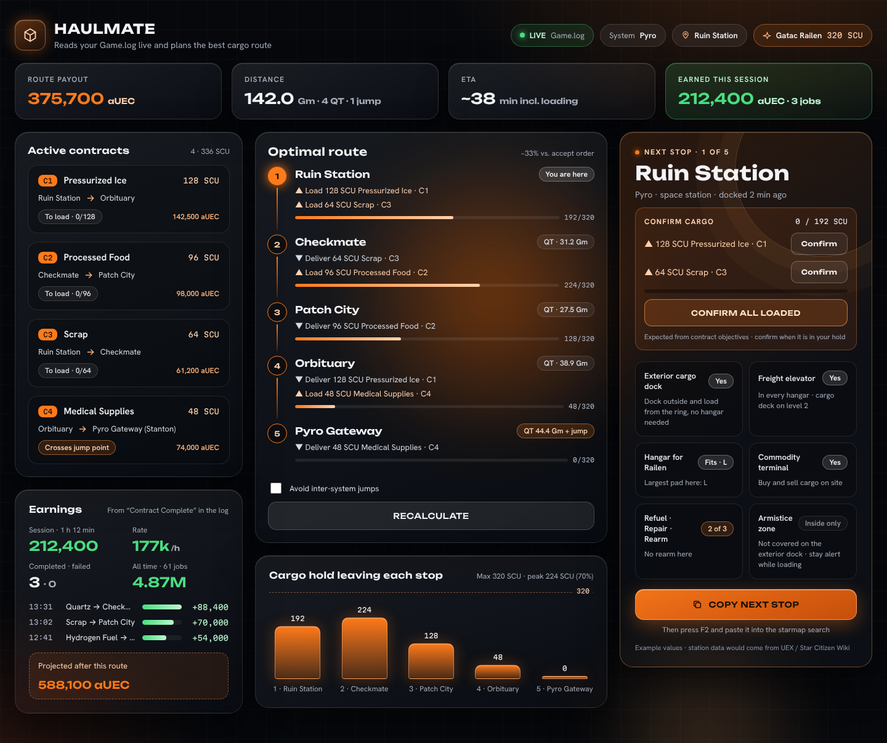

# Haulmate

**Rutas de transporte de carga a partir de tu `Game.log` de Star Citizen.**

Haulmate lee tu `Game.log` en directo mientras juegas, detecta los contratos de carga que aceptas y calcula el orden más rápido para cargar y entregar sin pasarte de la capacidad de tu nave. Funciona entero en tu navegador: sin instalador, sin cuenta, y el log nunca sale de tu PC.

[Read in English](README.md)

> **Proyecto fan no oficial.** Haulmate no está afiliado ni respaldado por Cloud Imperium Games ni Roberts Space Industries. Star Citizen®, Roberts Space Industries® y Cloud Imperium® son marcas de Cloud Imperium Rights LLC.



## Funciones

- **Lectura del log en directo** — sigue `Game.log` mientras el juego escribe y detecta un log nuevo al reiniciar el juego.
- **Contratos y objetivos** — contratos aceptados, completados, fallidos y retirados, con sus objetivos de recogida y entrega.
- **Mejor ruta** — solver exacto hasta 16 paradas y heurística a partir de ahí; respeta recoger antes de entregar y los SCU de tu nave.
- **Confirmación de carga** — marca la carga cuando está en tu bodega.
- **Ganancias de la sesión** — lo ganado en esta sesión y en total.
- Interfaz en **inglés y español**.

## Estado

Desarrollo temprano (`0.x`). El formato del log no está documentado y cambia entre parches. Consulta [el plan del proyecto](docs/PLAN.md).

## Ejecutarlo en local

Requisitos: [Node.js](https://nodejs.org/) 20 o superior, y Chrome o Edge.

```bash
git clone https://github.com/iarmen98/HaulMate.git
cd HaulMate
corepack enable    # o: npm install -g pnpm
pnpm install
pnpm dev
```

Abre la URL que muestra Vite (normalmente `http://localhost:5173`).

## Cómo se usa

1. Pulsa **Abrir carpeta del juego** y elige tu carpeta `StarCitizen\LIVE`, por ejemplo `C:\Program Files\Roberts Space Industries\StarCitizen\LIVE`.
2. Acepta contratos de carga en el juego. Aparecen en Haulmate según llegan al log.
3. Elige tu nave si Haulmate no la ha detectado y sigue la ruta.
4. Confirma la carga cuando esté en la bodega y copia la siguiente parada en el buscador del mapa estelar.

Si el navegador no deja abrir la carpeta, elige el propio archivo `Game.log` (sin actualización en directo; usa **Recargar** para leerlo de nuevo).

## Limitaciones

- La lectura en directo necesita la File System Access API: Chrome o Edge de escritorio.
- De momento solo se reconoce el texto del juego en inglés.
- Los contratos aceptados antes del arranque actual del juego están en logs anteriores y no se detectan.
- Las distancias entre ubicaciones son aproximadas.

## Privacidad y juego limpio

Haulmate solo lee `Game.log`. Nunca lee la memoria del juego, no inyecta nada, no captura la pantalla ni envía pulsaciones al juego. Consulta [PRIVACY.md](PRIVACY.md).

## Licencia

[MIT](LICENSE). Las fuentes (Unbounded, Hanken Grotesk, Martian Mono) están bajo SIL Open Font License 1.1.
