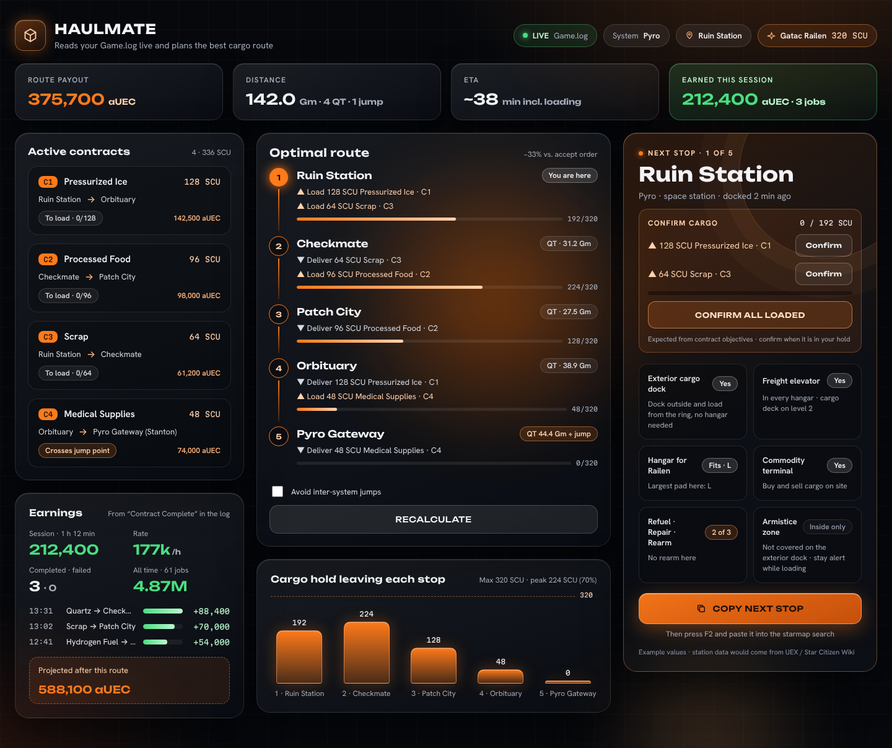

# Haulmate

**Hauling routes from your Star Citizen `Game.log`.**

Haulmate reads your `Game.log` live while you play, picks up the hauling contracts you accept and works out the fastest order to load and deliver them without going over your ship's cargo capacity. It runs entirely in your browser: no installer, no account, and the log never leaves your PC.

[Leer en español](README.es.md)

> **Unofficial fan project.** Haulmate is not affiliated with or endorsed by Cloud Imperium Games or Roberts Space Industries. Star Citizen®, Roberts Space Industries® and Cloud Imperium® are trademarks of Cloud Imperium Rights LLC.



## Features

- **Live log reading** — follows `Game.log` as the game writes it and picks up a new log when the game restarts.
- **Contracts and objectives** — accepted, completed, failed and withdrawn contracts, with their pickup and delivery objectives.
- **Best route** — exact solver for up to 16 stops, heuristic beyond that; respects pick-up-before-delivery and your ship's SCU.
- **Cargo confirmation** — tick off cargo as it lands in your hold.
- **Session earnings** — money earned this session and in total.
- **English and Spanish** interface.

## Status

Early development (`0.x`). The log format is undocumented and changes between patches, so expect rough edges. See [the project plan](docs/PLAN.md) for the roadmap.

## Run it locally

Requirements: [Node.js](https://nodejs.org/) 20 or newer, and Chrome or Edge.

```bash
git clone https://github.com/iarmen98/HaulMate.git
cd HaulMate
corepack enable    # or: npm install -g pnpm
pnpm install
pnpm dev
```

Open the URL Vite prints (usually `http://localhost:5173`).

## How to use

1. Click **Open game folder** and pick your `StarCitizen\LIVE` folder, for example `C:\Program Files\Roberts Space Industries\StarCitizen\LIVE`.
2. Accept hauling contracts in game. They show up in Haulmate as they appear in the log.
3. Pick your ship if Haulmate has not detected it, and follow the route.
4. Confirm cargo when it is in your hold, and copy the next stop into the starmap search.

If the browser refuses the folder, pick the `Game.log` file itself instead (no live updates in that mode, use **Reload** to read it again).

## Limitations

- Live reading needs the File System Access API: Chrome or Edge on desktop.
- Only English game text is recognised for now.
- Contracts accepted before the current game launch are in older logs and are not picked up.
- Distances between locations are approximate.

## Privacy and fair play

Haulmate only reads `Game.log`. It never reads game memory, injects anything, captures your screen or sends input to the game. See [PRIVACY.md](PRIVACY.md).

## Contributing

See [CONTRIBUTING.md](CONTRIBUTING.md). Please follow the [Code of Conduct](CODE_OF_CONDUCT.md) and report security issues as described in [SECURITY.md](SECURITY.md).

## Licence

[MIT](LICENSE). Fonts (Unbounded, Hanken Grotesk, Martian Mono) are under the SIL Open Font License 1.1.
