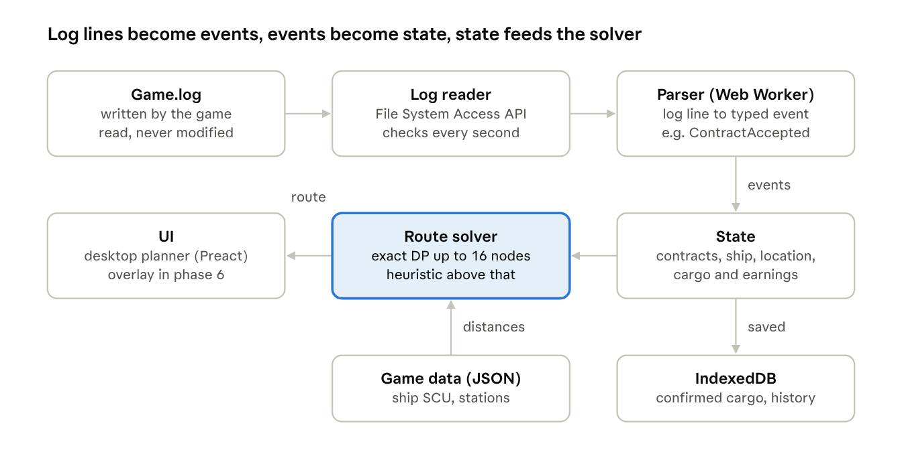
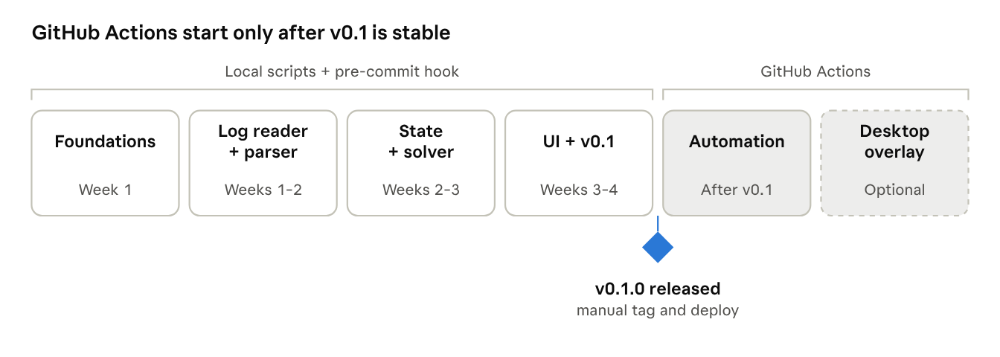

# Haulmate — Project plan

Nov 27, 2026 · Armen

## Summary

Haulmate is a static TypeScript web app that reads the Star Citizen `Game.log` from Chrome or Edge and works out the best hauling route. There is no installer and no `.exe`, so there is nothing to sign: it ships for free on GitHub Pages.

**v1 scope:** live log reading, contracts and objectives, current ship and location, best route within cargo capacity, cargo confirmation and session earnings.

**Out of v1:** transparent in-game overlay, desktop executable and code signing. They come in phase 6.

**Estimate:** a usable v0.1 in about 3–4 weeks of evenings, provided the log format is confirmed early with a real `Game.log`.

## Stack and architecture

Strict TypeScript with Vite, with the logic (parser, state, routing) kept apart from the UI so it can be tested without a browser. State is always rebuilt from the log's events: reloading the page re-reads the log and gives the same result.

| Part                 | Choice                                | Why                                                                    |
| -------------------- | ------------------------------------- | ---------------------------------------------------------------------- |
| Language             | TypeScript (`strict`)                 | Typed events, state and solver; one language across the project        |
| Build and dev server | Vite                                  | Fast start; outputs a static site                                      |
| UI                   | Preact                                | React's API in about 3 kB; enough for panels and lists                 |
| Tests                | Vitest                                | Same engine as Vite; parser tests run on real log excerpts             |
| Lint and format      | ESLint (typescript-eslint) + Prettier | The most common setup; fewer surprises for contributors                |
| Package manager      | pnpm                                  | Fast, with a strict lockfile                                           |
| Log reading          | File System Access API + Web Worker   | Parsing never blocks the UI                                            |
| Persistence          | IndexedDB                             | Game folder access, earnings history, confirmed cargo                  |
| Game data            | Versioned JSON in the repo            | Ships (SCU), stations, services and positions; a script regenerates it |
| Hosting              | GitHub Pages                          | Free, with the HTTPS the file API requires                             |

```text
haulmate/
├─ src/
│  ├─ log/          incremental Game.log reading
│  ├─ parser/       log line → typed event
│  ├─ state/        events → state (contracts, ship, location, earnings)
│  ├─ routing/      route solver, no browser dependencies
│  ├─ data/         ships, stations and distances (JSON + types)
│  └─ ui/           Preact components
├─ tests/fixtures/  anonymised Game.log excerpts
├─ scripts/         regenerates src/data from UEX or the wiki
└─ docs/adr/        architecture decision records
```



Data only flows one way: the UI never edits the log or the events, it only reads state and the solver's route.

## Repository best practices

MIT licence, code and commits in English, UI in English and Spanish, and a clear notice that this is a fan project. MIT is an OSI-approved licence, which SignPath requires if you later want free code signing ([conditions](https://signpath.org/terms)).

**Files from the first commit**

- [ ] `LICENSE` (MIT)
- [ ] `README.md` in English plus `README.es.md`: what it does, how to use it, screenshots, limitations
- [ ] `CONTRIBUTING.md`, `CODE_OF_CONDUCT.md` (Contributor Covenant) and `SECURITY.md`
- [ ] `PRIVACY.md`: the log is processed in your browser and never leaves your PC
- [ ] `CHANGELOG.md` in Keep a Changelog format, SemVer versions (`0.y.z` until 1.0)
- [ ] `.editorconfig`, `tsconfig.json` with `strict` and `noUncheckedIndexedAccess`
- [ ] Issue templates (bug with an anonymised log excerpt, feature idea) and a pull request template
- [ ] `docs/adr/0001-web-app-without-installer.md`: the first architecture decision
- [ ] `CLAUDE.md`: project rules and commands for Claude Code

**Conventions**

| What                    | Convention                             | Example                                   |
| ----------------------- | -------------------------------------- | ----------------------------------------- |
| Files                   | kebab-case                             | `route-solver.ts`                         |
| Variables and functions | camelCase, functions start with a verb | `parseLogLine`, `remainingScu`            |
| Types and interfaces    | PascalCase                             | `HaulingContract`                         |
| Events                  | PascalCase, past tense                 | `ContractAccepted`, `ObjectiveUpdated`    |
| Constants               | UPPER_SNAKE_CASE                       | `POLL_INTERVAL_MS`                        |
| Units                   | In the name                            | `distanceGm`, `capacityScu`, `payoutAuec` |
| Commits                 | Conventional Commits                   | `feat(routing): add capacity check`       |
| Branches                | type/description                       | `feat/route-solver`                       |

**Star Citizen and RSI**

- The name stands on its own: "Haulmate — hauling routes from your Star Citizen Game.log".
- A notice in the README and on the site: unofficial fan project, not affiliated with Cloud Imperium or RSI. Star Citizen and RSI are trademarks of Cloud Imperium Rights LLC ([RSI legal](https://robertsspaceindustries.com/en/legal)).
- No CIG logos or images. Only the `Game.log` is read: no game memory, no injection, no screen capture, no keys sent to the game.

## Route algorithm

The best route is solved exactly with dynamic programming (a Held-Karp variant) up to about 16 stops, roughly 8 contracts. Above that, an insertion heuristic plus local search takes over. This is the classic single-vehicle pickup and delivery problem, with precedence (pick up before delivering) and capacity ([TSPPD and Bellman-Held-Karp](https://www1.pub.informatik.uni-wuerzburg.de/pub/theses/2026-kroeger-praktikumsbericht.pdf); [DP with precedence and capacity](https://informahealthcare.com/doi/abs/10.1080/01966324.1986.10737198)).

**Model**

- Each contract adds pickup nodes and delivery nodes. A node is "load 128 SCU of C1 at Ruin Station", not the station. Two nodes at the same station cost 0 between them.
- The route starts where you are and does not need to return.
- Cost = estimated time: quantum travel by distance, plus a fixed time per stop (docking and freight elevator) and a time per SCU loaded or unloaded. The fixed times start as tunable settings.
- Across systems, the shortest path through jump points is computed separately (Dijkstra on the jump graph) and added as one more distance.
- Constraints: every delivery comes after its pickup, and cargo on board never exceeds the ship's SCU.

**Exact dynamic programming**

The state is (S, i): the set S of nodes already done and the last node i. The key point is that cargo on board depends only on S (picked up in S minus delivered in S), so capacity is checked once per set.

```latex
C(S \cup \{j\},\, j) = \min_{i \in S} \big[\, C(S, i) + d(i, j) \,\big] \quad \text{if } \mathrm{pred}(j) \subseteq S \ \text{and} \ \mathrm{load}(S \cup \{j\}) \le Q
```

- Cost O(2ⁿ · n²): 16 nodes is about 17 million operations, under a second in a Web Worker. Precedence prunes many sets, so it is lower in practice.
- Each state keeps its predecessor to rebuild the route.

**Heuristic above 16 nodes**

1. Insertion: add each pickup-delivery pair at its cheapest valid positions.
2. Local search: move pairs and reorder segments, always respecting precedence and capacity.
3. Stop on a time budget (for example 300 ms) and keep the best route found.

**Solver tests**

- Up to 8 nodes, compare against brute force (every valid permutation) in randomised tests with fast-check.
- Fixed cases: contracts sharing a station, capacity exactly full, one jump between systems.

## When cargo exceeds capacity

Contracts adding up to more than the ship's SCU is not a problem by itself: only what is on board at the same time counts, and the solver already interleaves deliveries to free space. If it still does not fit, it is handled in this order:

1. **Fits by interleaving:** for example 336 SCU of contracts on a 320 SCU Railen. The solver delivers before loading the next one. Nothing to do.
2. **One contract is larger than the hold** (for example 400 SCU): it is split into batches of at most the capacity, each with its own pickup and delivery. This relies on the game accepting partial deliveries, which the "0/48 SCU" counter suggests; to be confirmed with a log.
3. **No valid order exists:** Haulmate offers two ways out with their cost, and you choose:
   - do it in several trips ("2 trips, +14 min");
   - postpone or abandon the contract with the lowest aUEC per hour ("postpone C2, −98,000 aUEC"). With few contracts every combination is tried.

**Safety margin:** boxes do not always pack perfectly into the cargo grid, so usable capacity is a setting (100 % by default, configurable, for example 95 %).

**Early warning:** as soon as the log shows a new contract that makes the route impossible, Haulmate flags it, so you can abandon it before flying out to load.

## Phases

Four phases reach a usable v0.1 without GitHub Actions; automation arrives in phase 5, once the core is stable. From day one, every check is a `pnpm` script (`lint`, `typecheck`, `test`, `build`) run locally by a pre-commit hook, so the later CI only has to call the same scripts.



1. **Foundations (week 1):** repo, licence and docs from the list above, tooling (pnpm, Vite, TypeScript, ESLint, Prettier, Vitest), lefthook pre-commit hook, `CLAUDE.md`, first ADR. Collect real `Game.log` files from hauling sessions and cut anonymised fixtures.
   - Gate: `pnpm lint typecheck test build` passes on a clean clone.
2. **Log reader and parser (weeks 1–2):** folder access, incremental reading, new log on game restart, typed events for contracts, objectives, location, ship and payouts.
   - Gate: every hauling line in the fixtures maps to an event; no unknown hauling lines.
3. **State and solver (weeks 2–3):** reducer from events to state, exact DP solver, heuristic, capacity handling and trip splitting.
   - Gate: solver matches brute force in randomised tests; 16 nodes in under 1 s.
4. **UI and v0.1 (weeks 3–4):** desktop planner from the mockup, cargo confirmation, earnings, English and Spanish. Manual deploy to GitHub Pages and a hand-written `v0.1.0` tag and changelog entry.
   - Gate: one full hauling session played with Haulmate open, no blocking bugs.
5. **Automation (after v0.1 is stable):** GitHub Actions for CI on every pull request (lint, typecheck, test, build), deploy to Pages on `main`, Release Please for versions and changelog from Conventional Commits, Renovate or Dependabot, and branch protection that requires green CI.
6. **Desktop overlay (optional):** a Tauri app that reuses the same UI in a transparent, click-through window with a global hotkey. First release unsigned, then apply to SignPath Foundation with the signing step in the release workflow.

## Code signing

The web app needs no signing. It only matters if phase 6 ships an `.exe` for the overlay, and then the free route is SignPath Foundation. Following this plan already covers almost everything they ask for ([SignPath Foundation conditions](https://signpath.org/terms)):

| SignPath requirement                                                          | How the plan covers it                               |
| ----------------------------------------------------------------------------- | ---------------------------------------------------- |
| OSI-approved licence, no commercial dual licensing, no proprietary components | MIT and open-source dependencies only                |
| Actively maintained and already released in the form to be signed             | Release the unsigned `.exe` at least once first      |
| Functionality documented on the download page                                 | README and releases page                             |
| Verifiable builds from source and manual approval of each release             | GitHub Actions from phase 5, approval in SignPath    |
| MFA on GitHub and SignPath for every team member                              | Turn on GitHub MFA from the start                    |
| Defined roles: authors, reviewers, approvers                                  | You hold all three while you are the only maintainer |
| "Code signing policy" page with the attribution line, roles and privacy       | A README section                                     |
| An uninstaller if there is an installer                                       | A portable `.exe` with no installer avoids it        |

The certificate is issued to SignPath Foundation, so Windows shows the foundation as the publisher, not you.

## Risks and open questions

The biggest risk is the log itself: its format is not documented and can change with any patch. Everything else has a known workaround.

| Risk                                                        | Impact                                         | Mitigation                                                                               |
| ----------------------------------------------------------- | ---------------------------------------------- | ---------------------------------------------------------------------------------------- |
| Log format unknown or changed by a patch                    | Contracts or objectives go undetected          | Fixtures per game version, an "unknown hauling line" counter, quick patch releases       |
| Game played with a translation (e.g. Spanish)               | Objective text does not match English patterns | Support English first; match localised text through `global.ini` later                   |
| Half-written lines read mid-write                           | Broken or duplicated events                    | Buffer until a newline before parsing                                                    |
| Browser blocks the game folder (e.g. under `Program Files`) | Log cannot be opened                           | Test in a phase 1 spike; fallback: pick the `Game.log` file itself                       |
| Folder permission asked again on each visit                 | One extra click per session                    | Store the handle in IndexedDB; one-click re-grant                                        |
| Station data incomplete or outdated                         | Wrong distances or services                    | JSON with source and date per entry; regeneration script                                 |
| Quantum travel time estimates off                           | Route order not truly the fastest              | Tunable timings; later, learn real times from log timestamps                             |
| RSI changes its stance on third-party tools                 | Tool becomes disallowed                        | Read-only and local by design; fan-project notice; ask RSI support in writing before 1.0 |
| Similar tools already exist                                 | Fewer users                                    | Clear difference: reads the log live, no screenshots or manual entry                     |

**Open questions**

- [ ] Does the log record pickups and delivery counter updates for hauling objectives?
- [ ] Does the game accept partial deliveries of one contract?
- [ ] Which source for station positions and services, and does its licence allow bundling the data (UEX, Star Citizen Wiki)?
- [ ] Can Chrome and Edge open the default `Program Files` install folder?
